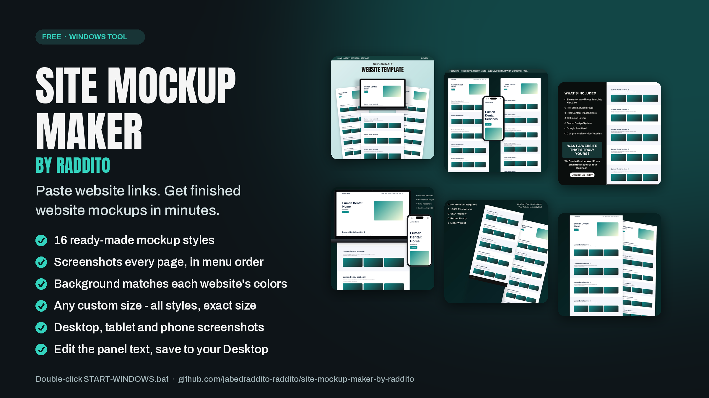

# Site Mockup Maker by Raddito



Paste website links (or add your own screenshots) and get finished website mockups in 21 ready-made styles, saved to `Desktop\Mockups\<website name>\`.

## Install (Windows)
1. Click **Code → Download ZIP** and unzip it (or `git clone` this repo).
2. Double-click **START-WINDOWS.bat**. The first run installs Python 3.12, Playwright, Pillow and Chromium (a few minutes, once).
3. The Site Mockup Maker window opens. Next time, double-click the same file.

**If setup stops:** unzip the folder first (do not run from inside the ZIP), install Python 3.12 from python.org with "Add python.exe to PATH" ticked, delete the `.venv` folder if it exists, and run START-WINDOWS.bat again. The black window shows which step failed.

## Use
- **Clean light window:** the style gallery shows a thumbnail of every style. Click a thumbnail to tick/untick it; hover to see a bigger sample in the Preview box (click the preview to enlarge).
- **Save folder:** box 5 sets where mockups are saved (default: Desktop\Mockups). *Browse...* picks any folder.
1. **Box 1** – paste one website link per line (optional name first: `Lumen Dental | https://site.com`), or choose *My screenshots* and add image files.
2. **Box 2 – styles** – click the thumbnails of the styles you want (Style 1–20 and Elementsdoc). *Edit panel text…* changes the wording inside the panels.
3. **Box 3 – size & look** – *Each style's own size* keeps the sample sizes, or type a custom size to make every style exactly that size; also device size, background, device color and **File type** (JPG, PNG or WebP, with a quality setting).
4. **Box 4 – pages & save** – *Only pages in the menu* (default) or *All pages of the website*; set *Max pages per website*.
5. **Only take website screenshots** – saves every page (`01_Home.png`, `02_About_Us.png` …) with optional `_Tablet` and `_Mobile` versions, no mockups.
6. Press **Make Mockups**.

Backgrounds match each website's own colors (settings: auto / brand / site / white / own color).

## Files
| File | What it is |
|---|---|
| `app.pyw` | the window |
| `mockup_maker.py` | page capture, naming, and the mockup engine (also runs from the command line) |
| `styles.py` | the 21 styles and the editable panel text |
| `settings.txt` | default settings (size, styles, background, pages) |
| `fonts/` | Anton and Archivo (SIL Open Font License) |
| `badges/` | put Elementor / WordPress / client logo PNGs here (file names containing `elementor` or `wordpress` are used by the styles that show logos) |

## Command line
```
python mockup_maker.py urls.txt --pages-from menu --size auto
python mockup_maker.py urls.txt --shots-only --shots-tablet --shots-mobile
python mockup_maker.py --images "C:\path\to\screenshots"
```

## Team notes
- Work on your own branch and open a pull request; keep `settings.txt` for shared defaults only.
- Don't commit client logos or generated mockups (see `.gitignore`).
